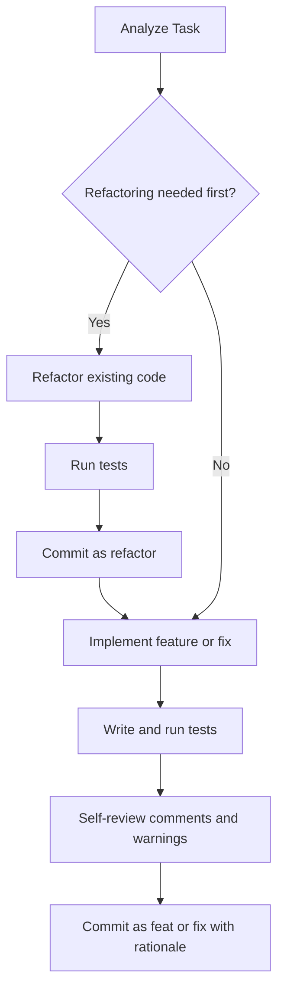

# Programming Guidelines

Standard practices for writing clean code, managing commits, and documenting decisions.

## 1. Git Commit Principles

### 1.1 Follow Conventional Commits
All commit messages must follow the [Conventional Commits](https://www.conventionalcommits.org/) specification:

```text
<type>[optional scope]: <description>

[optional body: context, rationale, trade-offs]

[optional footer(s): issue references, breaking changes]
```

Primary types:
- `feat`: A new feature
- `fix`: A bug fix
- `refactor`: A code change that neither fixes a bug nor adds a feature
- `perf`: A code change that improves performance
- `test`: Adding missing tests or correcting existing tests
- `docs`: Documentation changes only
- `style`: Changes that do not affect the meaning of the code (whitespace, formatting, semicolons)
- `chore`: Maintenance tasks, build processes, or auxiliary tools

See [references/commits.md](./references/commits.md) for detailed guidelines.

### 1.2 Separate Refactoring from Functional Changes
Keep commit scopes atomic and clearly isolated.

- **Never combine refactoring with features or fixes**:
  If code cleanup is needed before adding a feature or fixing a bug, perform and commit the refactoring first (`refactor:`), verify existing tests pass, and then implement the functional change in a separate commit (`feat:` or `fix:`).
- **Atomic commits**:
  Each commit must represent a single logical change and leave the codebase in a building and test-passing state.

### 1.3 Record Decisions and Rationale in Commit Messages
- Explain the reason for the change (Why).
- Document alternatives considered and why they were rejected.
- Keep this context in the commit message body so future maintainers understand the design decisions through `git log` and `git blame`.

## 2. Code Comment Principles

### 2.1 Keep Comments Minimal
- Write self-explanatory code using clear naming, small functions, and guard clauses.
- Do not write comments that merely repeat what the code does.

### 2.2 Comment Only for Warnings and Critical Caveats
Write comments only when special attention is required when reading or modifying the code:
- **Pitfalls**: Non-obvious behavior, counter-intuitive logic, or workarounds for bugs in external libraries.
- **Constraints**: Critical ordering requirements, thread-safety assumptions, or external API limitations.
- **TODO / FIXME**: Temporary workarounds with clear conditions for resolution.

### 2.3 Keep History and Rationale Out of Code Comments
- Do not write decision history, discarded alternatives, or meeting notes in source comments.
- Record that context in commit messages, pull requests, or design documents.

See [references/comments.md](./references/comments.md) for examples and refactoring techniques.

## 3. Code Design Principles

1. **Single Responsibility**: Each function, class, or module must handle one responsibility.
2. **KISS and YAGNI**: Avoid premature abstraction and unnecessary generalizations.
3. **Guard Clauses / Early Return**: Handle edge cases and error conditions early to avoid deep nesting.
4. **Explicit Naming**: Name variables, functions, and types clearly based on domain intent. Avoid vague names like `data`, `info`, or `temp`.
5. **Robust Error Handling**: Do not swallow errors. Propagate context or recover cleanly.
6. **Testability**: Keep side effects isolated and separate pure logic from I/O.

## 4. Development Workflow



### Pre-commit Checklist

- [ ] Does the commit type match the change?
- [ ] Are refactoring and behavioral changes strictly separated into distinct commits?
- [ ] Is the commit atomic and scoped to one purpose?
- [ ] Does the commit message explain why the change was made and the rationale behind it?
- [ ] Are redundant comments removed from the code?
- [ ] Are comments reserved strictly for critical caveats and warnings?
- [ ] Do all tests pass?
